# Project 4: Planning

NetIDs: jlt243, as4638, as4642

## Q0. Battery Mounting Bracket

We picked up a battery mounting bracket from the lab and installed it under the tail runner of our car, so that the weight of the battery is supported by the bracket instead of the battery port on the board.

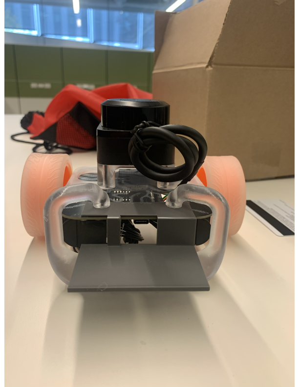

## Q1. Searching on R2 Problems using A*

The roadmap that A* searches over is a graph of collision-free sample points connected by straight edges. The figure below shows the simple roadmap for `map1.txt` that the rest of Q1 builds on.

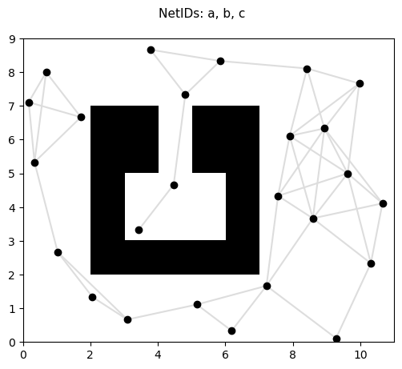

**Q1.1.** For `R2Problem`, the state is just an (x, y) position, so the cost between two states is the straight-line Euclidean distance between them. We implemented `compute_distance` by first making both inputs two-dimensional with `np.atleast_2d`, then taking the difference, squaring it, adding the x and y parts, and taking the square root. Because this is done with NumPy arrays, the same code works whether we pass in a single state or a whole array of states, which matters because `cost_to_go` uses this function to compute the heuristic for many nodes at once. Our implementation passes `test/problems.py`.

**Q1.2.** In the main A* loop, the node with the lowest f-value is popped from the priority queue, and each of its neighbors that has not been expanded yet is considered. For each one, we compute its cost-to-come as the current node's cost-to-come plus the length of the edge between them, and then its f-value as that cost-to-come plus the heuristic estimate to the goal. We then push a new `QueueEntry` with this information into the queue, with the current node recorded as its parent. Once the goal is expanded, `extract_path` starts at the goal and keeps following the parent pointers until it reaches the start, and then reverses the list so the path goes from start to goal. Our implementation passes the `test_astar_r2problem` suite in `test/astar.py`.

The first figure is the A* path on `map1.txt` from (1, 6) to (9, 3), which matches the reference plot. The second is the shortest path on `map2.txt` from (252, 115) to (350, 350).

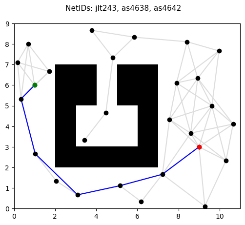
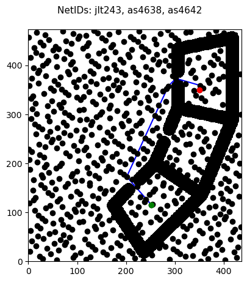

## Q2. Searching on R2 Problems using RRT

**Q2.1.** RRT grows a tree out from the start by repeatedly sampling random points in free space. In `extend`, we take the vector pointing from the nearest tree node `x_near` to the sampled point `x_rand`, scale it by `eta`, and add it to `x_near` to get the new point. We then check that the edge from `x_near` to this new point is collision-free using `check_edge_validity`, and return `None` if it is not. In `Plan`, for every sampled point we find the nearest node already in the tree, call `extend` towards the sample, and if the new point is valid, add it to the tree as a vertex along with an edge back to its parent. We stop as soon as a new vertex lands within the epsilon threshold of the goal. Our implementation passes `test/rrt.py`.

The first figure is the RRT path on `map1.txt` from (1, 6) to (9, 3), which matches the reference plot. The second is the RRT path on `map2.txt` from (252, 115) to (350, 250), where the red lines show the tree and the blue line is the final path.

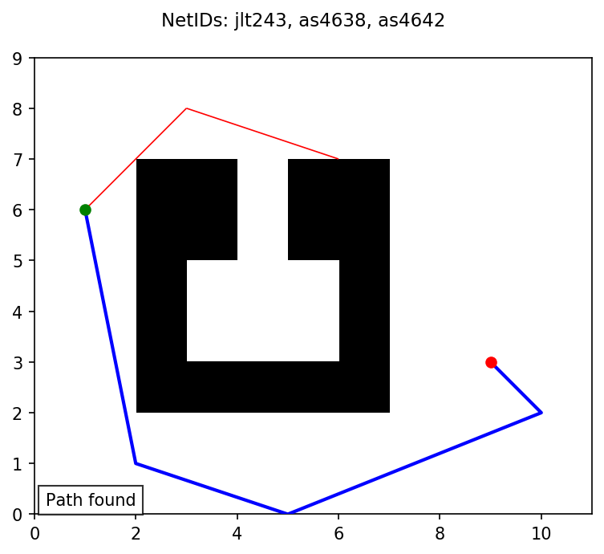
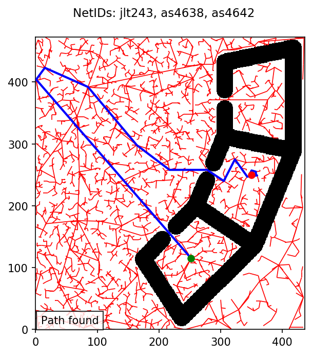

**Q2.2.** The path that RRT returns is usually far from optimal, because every edge just goes to wherever a random sample happened to fall. To clean this up, `ShortenPath` walks along the path and, for each node, checks whether the node before it can connect directly to the node after it without hitting an obstacle. If it can, the middle node is not needed and is removed, and the check is repeated from the same position. Otherwise we move on to the next node. In the figure below, the original RRT path is shown in blue and the shortened path in green, which matches the reference plot. Our implementation passes `test/rrt_shortcut.py`.

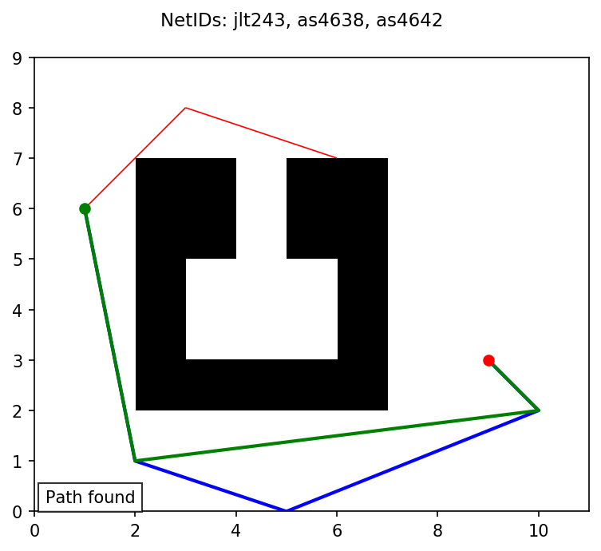

## Q3. Tradeoffs between A* and RRT

For this question, A* uses a lattice sampler with 100 vertices and a connection radius of 3. On a 20 × 20 map, this places the roadmap vertices on a regular grid at the odd coordinates (1, 3, 5, ..., 19), 2 units apart. Each vertex connects to its horizontal and vertical neighbors (distance 2) and its diagonal neighbors (distance 2√2 ≈ 2.83), but nothing further. RRT, on the other hand, samples directly from any free cell on the map. Both of our maps are designed around this difference. Both maps pass `test/tradeoff.py`.

**A* beats RRT.** In `astar_beats_rrt_map.txt`, the start at (1, 1) leads into a short corridor, which feeds into a narrow diagonal "staircase" passage that is only one cell wide. This passage then ends in a corridor down the right edge of the map to the goal at (19, 19). Next to the staircase there is a large open region, separated from it by a one-cell wall that only touches the passage at the corners of the cells.

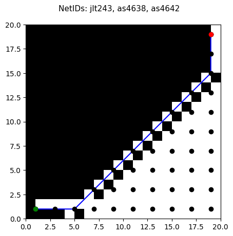

A* does well on this map because the lattice happens to place vertices right on the staircase, and its diagonal edges run straight down the passage. As a result, A* simply searches the graph and finds the path (length 27.8) in a few milliseconds. RRT, however, always grows from the node in the tree that is nearest to each random sample. Since the open region is much larger than the passage, most of the samples land there, and the tree fills that region quickly. Once that happens, for every cell in the staircase, the nearest tree node is sitting on the other side of the wall, and the straight edge to it passes through the wall, so the extension is rejected. Because the next step of the passage is always closer to the open region than to the end of the tree inside the passage, RRT keeps getting stuck in the same place no matter how long it runs. In the test, RRT runs out of its 10-second budget without finding a path. We also tried seven different random seeds and let RRT run for about 70 seconds each, and in every case the tree stopped growing at around 114 nodes without ever reaching the goal. This is a well-known weakness of RRT in narrow passages. A large area of free space that does not lead anywhere ends up pulling the tree's growth away from the small region that actually matters.

**RRT beats A*.** In `rrt_beats_astar_map.txt`, the map is split into two halves by a wall that is two rows thick, with a single one-cell gap at x = 10.

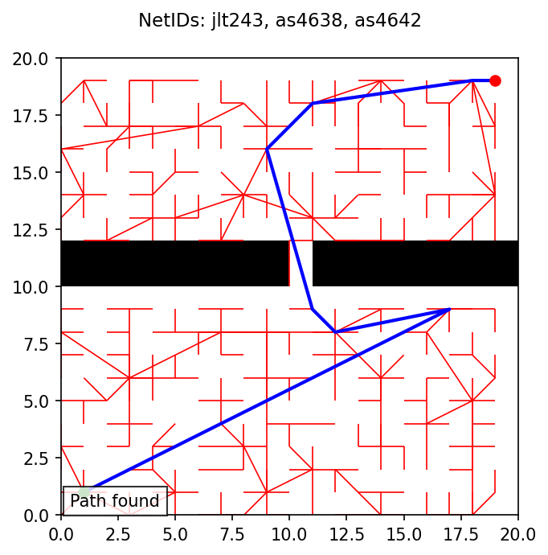

Here, A* cannot find a path at all, even though one exists. The gap is at an even x-coordinate, so none of the lattice vertices fall inside it. On top of that, the wall is thick enough that the nearest lattice vertices on either side are 4 apart, which is more than the connection radius of 3. This means the roadmap is split into two disconnected pieces, and A* correctly reports that there is no path on the roadmap. RRT does not have this problem, because it can sample any free cell, including the cells in the gap. It eventually draws a sample in the gap, grows through it, and finds a valid path in about one second, as shown in the figure.

**Tradeoffs.** Taken together, these two maps show that the two planners fail in different ways. A* on a roadmap gives consistent results, and the path it returns is the shortest one available on the graph. Once the roadmap is built, searching it is also very fast, and the same roadmap can be reused for many different queries. However, A* can only be as good as its roadmap. If the sampling or the connection radius misses a narrow passage, A* will report that no path exists, even when one does. RRT, in contrast, does not need a precomputed roadmap and can find its way through gaps that a fixed lattice misses. Its downsides are that the paths it finds are random and usually far from the shortest, which is why the shortcutting in Q2.2 is needed, its runtime changes from run to run, and its greedy nearest-node growth can stall badly in narrow passages next to large open areas.

## Q4. Planning for the Car in SE(2)

**Q4.1.** Unlike the R2 problems, the car's state in SE(2) also includes its heading. Since the car can only drive forward and has a minimum turning radius, the straight-line distance is no longer a good measure of how far apart two states are. Instead, the cost is the length of the Dubins path, which is the shortest path between two poses that only uses arcs at the maximum curvature and straight lines. We implemented `compute_distance` for `SE2Problem` by calling `dubins.path_length(q1, q2, self.curvature)` on the two arrays of states. One important detail is that this distance depends on the direction. Driving from A to B is not the same as driving from B to A, which is why the SE(2) roadmap is a directed graph. For this reason, `q1` is always passed as the start and `q2` as the end, which matches how `cost_to_go` and the roadmap call this function. The Dubins length also ignores obstacles, so it never overestimates the true cost and is still a valid heuristic for A*. Our implementation passes both the `test_astar_r2problem` and `test_astar_se2problem` suites in `test/astar.py`. The figure below shows the SE(2) A* path on `map1.txt` from (1, 6, 0°) to (9, 3, 45°) with curvature 3, which matches the reference plot.

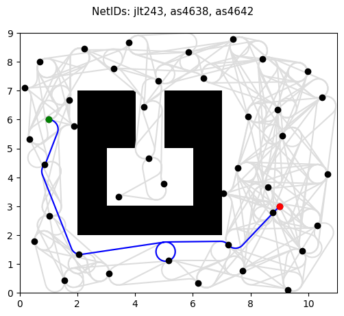

**Q4.2.** For this question, we ran `astar_test.launch` with `dubins:=true` and chose a start and goal that A* could not connect. The start pose is the one with the purple circle around it (the initial pose estimate) in the bottom-right room, facing almost straight at the right-hand wall. The goal pose is in the small room on the left, facing towards the short wall above it.

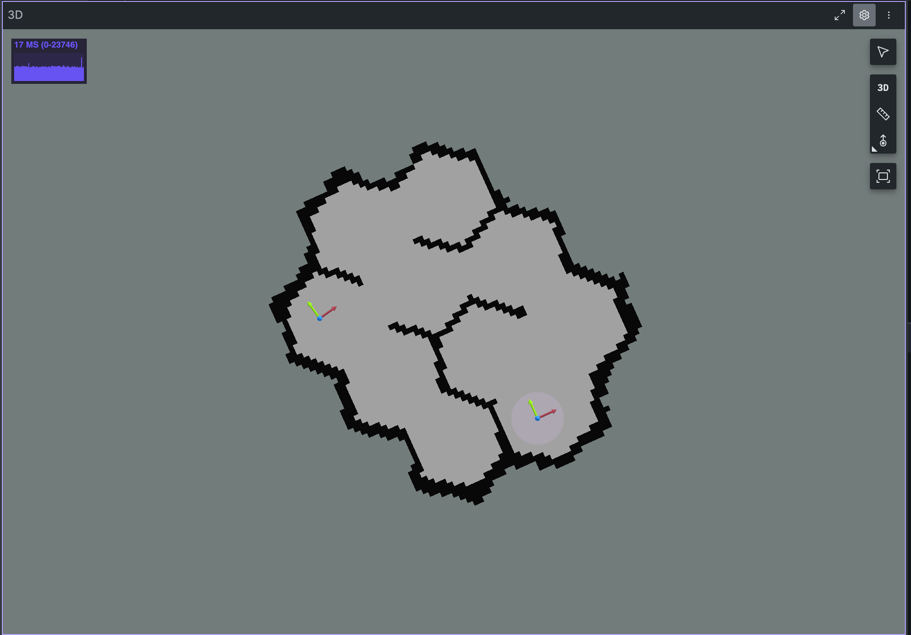

The roadmap itself was built without any problems, with 1000 vertices and 35,763 edges. However, A* could not find a path between the two poses and reported that the goal node (1001) is not reachable from the start node (1000).

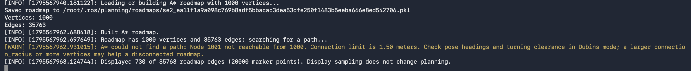

The path is not valid because of the car's heading and turning constraints in such a small space. In SE(2), the car can only drive forward along curves with a minimum turning radius of about 0.33 m (curvature of 3 per meter), so every edge in the roadmap is a one-way Dubins curve. On top of that, an edge is only added if its curve is at most 1.5 m long and does not pass through a wall. The whole arena is only about 3 m × 3 m, and the start pose sits in a small corner room, pointing almost directly at the wall. To leave this room, the car would have to swing around in a forward-only arc, which needs roughly 0.67 m of space for a U-turn. As a result, most of the nearby roadmap vertices would need a Dubins curve that either runs into the wall or is longer than 1.5 m, so the start has very few or no valid edges leading out into the rest of the roadmap. The goal has the same problem in reverse. It is in a tight space facing a wall, and the car has to arrive with exactly that heading, so very few curves can reach it. Since the edges only go one way, it is not enough for the two poses to be in free space. There has to be a chain of drivable edges all the way from the start to the goal, and for these two poses there is not one. In R2, where heading does not matter and edges are straight lines, these two positions would be easy to connect, which shows that the failure comes from the heading and turning radius constraints rather than from the walls alone. A larger connection radius, more vertices, or less constrained headings would give the planner a better chance of connecting them.

**Q4.3.** We then ran the RRT node on the same map and clicked the same start and goal poses, with both `/astar_path_viz` and `/rrt_path_viz` enabled in Foxglove. In the figure below, the blue line is the RRT path, and the light red lines are the tree that RRT grew while searching.

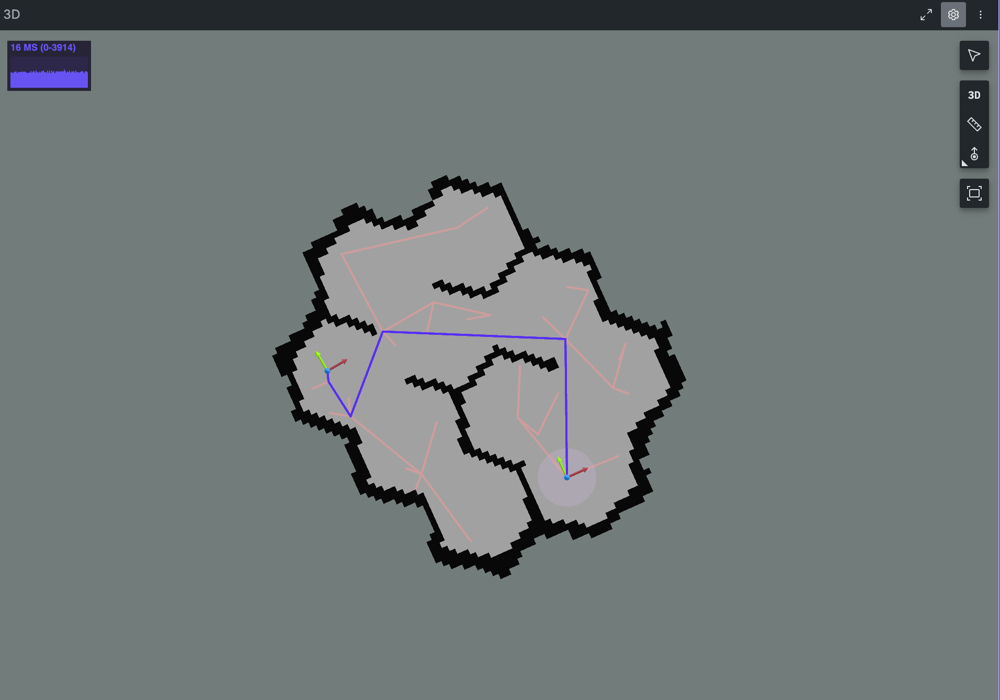

The A* path topic was also enabled, but there was nothing to draw, since Foxglove reports that the `/astar_path_viz` marker has no points. This is because A* in SE(2) did not find a path for these poses.

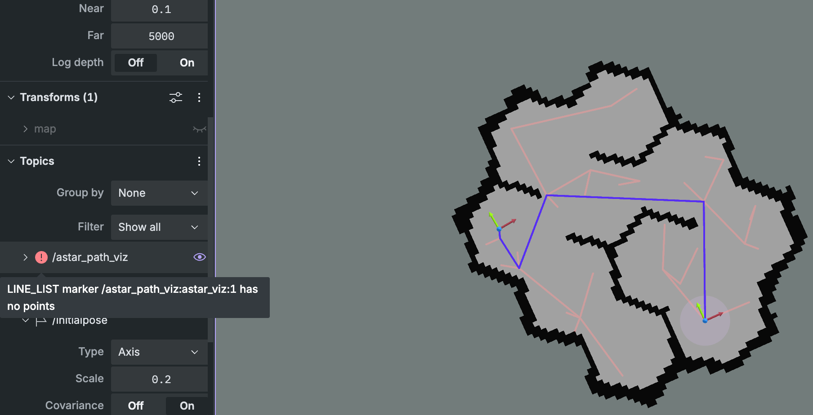

Comparing the two, RRT found a path where A* could not, but it was solving a different and easier problem. The RRT node plans in R2, which means it only considers the (x, y) position, connects points with straight lines, and ignores both the heading and the turning radius. This shows up clearly in its path. It leaves the start by going straight up out of the bottom-right room, which is sideways to the direction the car is facing. It then makes several sharp corners in the middle of the arena and in the left room, and reaches the goal without matching the goal heading. A car that can only drive forward with a 0.33 m turning radius cannot make these instant turns, so even though the RRT path is free of collisions, the car cannot actually follow it as it is. The path is also clearly not the shortest, since it goes down and then back up into the left room, and the red tree shows how RRT spreads random branches across the free space until one of them reaches the goal. A* in SE(2), on the other hand, only uses Dubins edges that respect the car's heading and turning radius. This means any path it returns is one the car could actually drive, and it is the shortest such path on the roadmap. The downside is that when the start or goal is too constrained, as with these poses facing walls in tight rooms, it may not find a path at all. Overall, RRT in R2 is more flexible and will usually find some path, while A* in SE(2) is stricter but gives paths that are actually feasible for the car.

## AI usage (-8 pts if incomplete)
**Did you use AI for this assignment? If so, how was it used? Eiher state "no AI was used" or explain *how* it was used. Failure to complete this section will result in 10% of your grade being lost**

Used ChatGPT to understand A* and RRT path planning algorithms and used it as a guidance to code. It helped us debug error involving variable assignments, incorrect path costs, collision checking and nearest neighbour searches

Used AI to help us design the two Q3 maps and checked them with `test/tradeoff.py`, implement the one-line `SE2Problem.compute_distance` for Q4.1 and checked it against the tests and the reference plot, 
Took help of AI to fix Docker container and the missing ROS dependencies needed for Q4.2 and Q4.3. Also used AI to remove awkward phrasing and improve flow of answers with correct grammer for Q3, Q4.2, and Q4.3.

## Feedback

**How much time did you spend on this assignment?**

**Do you have any feedback for this assignment?**
